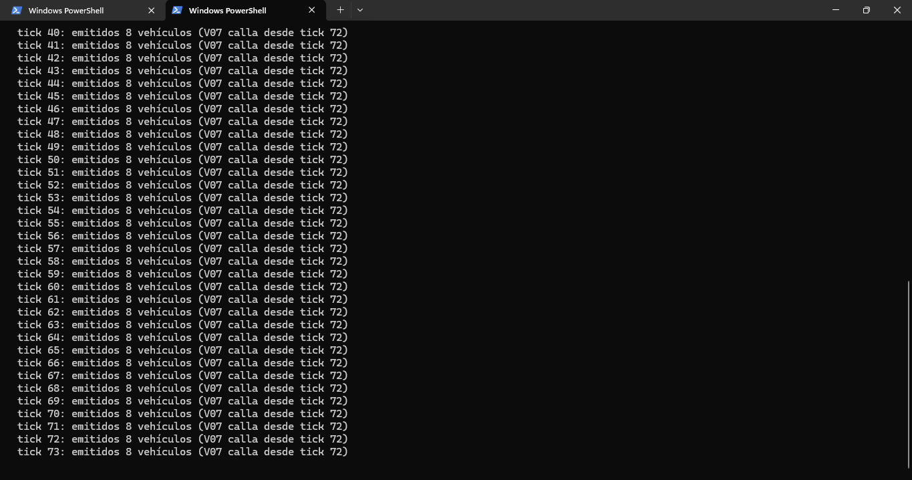
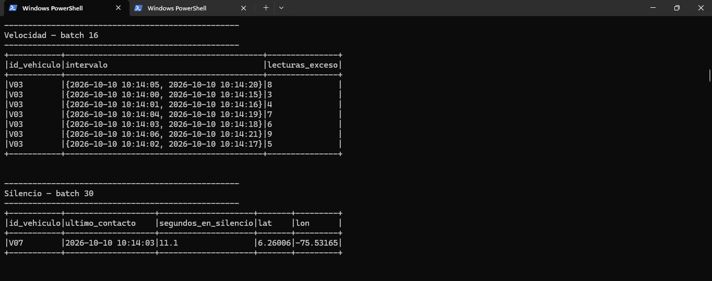

# TRABAJO 3: PIPELINE DE STREAMING EN TIEMPO REAL
**Materia:** Big Data  
**Profesor:** Alejandro Mery Agudelo  

### Integrantes:
- **Estudiante 1:** Martin Restrepo Coral
- **Estudiante 2:** Miguel Ángel Zuleta

### Caso Elegido:
**CASO A — Monitoreo de una Flota de Vehículos**  

---

## 1. Funcionamiento del Detector

El pipeline de streaming utiliza Apache Kafka para la ingesta de eventos de telemetría (vehículos transmitiendo cada segundo) y Spark Structured Streaming para el procesamiento.
Se empleó el esquema definido para decodificar los eventos JSON. Para manejar retrasos en la red, se implementó un `watermark` de 5 segundos.

Las tres reglas se implementaron de la siguiente manera:
1. **Exceso de Velocidad Sostenido:** Se utilizó una ventana deslizante de tiempo (*sliding window*) de 15 segundos moviéndose cada 1 segundo.
2. **Caída Anómala de Combustible:** Como `LAG()` no se aplica a flujos directos, se usó `foreachBatch` para mantener en memoria la lectura del lote anterior y compararla con el actual.
3. **Vehículo en Silencio:** También mediante `foreachBatch`, manteniendo el registro del último momento en que cada vehículo transmitió, lanzando alerta si pasan más de 10 segundos sin reporte.

---

## 2. Resultados de las Reglas

1. **Regla 1 (Exceso de Velocidad):** Detectó con precisión al vehículo **V03**, que acelera a más de 100 km/h sostenidamente.
2. **Regla 2 (Combustible):** Detectó correctamente las pérdidas anómalas (robo/fuga) en el vehículo **V05**.
3. **Regla 3 (Silencio):** Detectó exitosamente al vehículo **V07**, el cual deja de emitir datos repentinamente, mostrando su última latitud y longitud conocida.

---

## 3. Respuestas a las Preguntas de Negocio

**A. ¿Qué vehículo dio más alertas?**  
El vehículo **V03** (exceso de velocidad) es el que genera mayor cantidad de alertas de forma numérica, dado que la infracción intersecta múltiples ventanas de 15 segundos sucesivas.

**B. ¿El silencio se detecta rápido o tarde?**  
Se detecta rápido, en aproximadamente 10 a 12 segundos. Este umbral es ideal porque permite reaccionar de forma casi inmediata frente a posibles accidentes, pero da un margen suficiente para no arrojar falsos positivos por fallos de red breves o intermitencias menores.

**C. ¿Qué harían en producción con cada tipo de alerta?**  
- **Exceso de Velocidad:** Registrar en el perfil del conductor, emitir alerta visual/sonora en cabina y, si persiste, contactar por radio.
- **Caída de Combustible:** Verificar si la ubicación es una gasolinera. De lo contrario, contactar de inmediato por riesgo de robo en caliente o daño del tanque.
- **Vehículo en Silencio:** Solicitar contacto satelital o celular inmediato al conductor; despachar patrulla de auxilio vial a la última coordenada por presunto accidente grave.

---

## 4. Retos Técnicos 

- **Incompatibilidad de Java:** Spark en Windows arrojó errores por tener Java 23. Se solucionó configurando la variable `JAVA_HOME` apuntando específicamente a OpenJDK 17.
- **Winutils de Hadoop:** Se presentaron excepciones por la falta de `winutils.exe` al requerir manipulación de dependencias (JARs). Se configuró `HADOOP_HOME` en Windows apuntando a los binarios nativos correctos.
- **Error "Connection reset" de PySpark:** Hubo fallos de socket al reutilizar workers en Windows con `foreachBatch`. Se corrigió estableciendo `spark.python.worker.reuse = false` y utilizando la ruta corta (8.3) de Python.
- **Uso de LAG en Streaming:** Dado que Spark Structured Streaming no soporta directamente `LAG`, el reto se resolvió usando `foreachBatch` para comparar estados en memoria entre los micro-lotes.

---

## 5. Capturas de Pantalla (Ejecución en Vivo)

